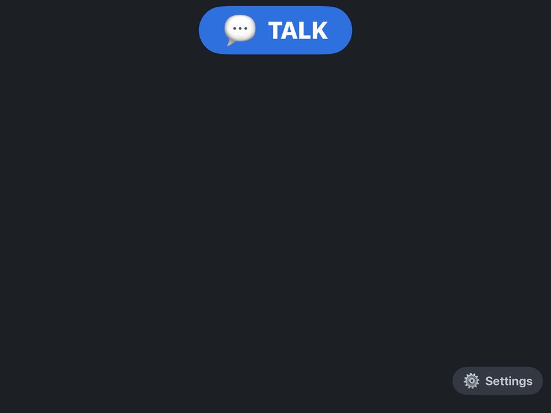
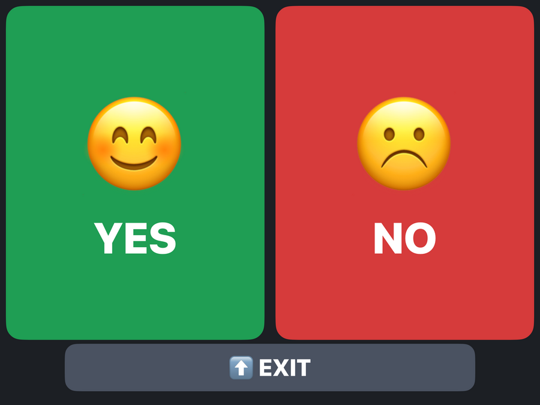
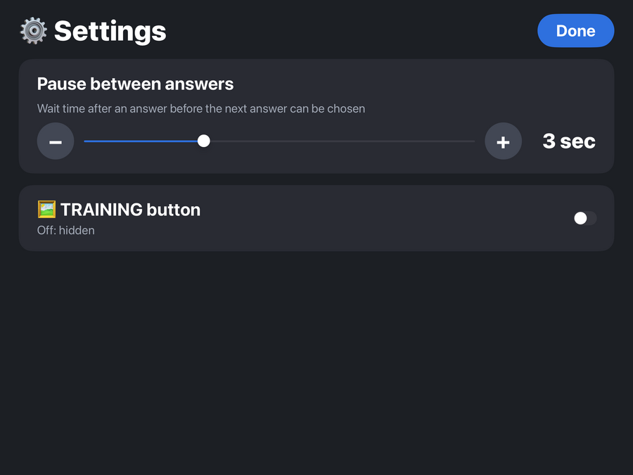

# YES / NO — answer with your eyes (iPad)

A free, simple iPad app for people who **cannot speak and cannot use their hands**, but **can
move their eyes**. They look at **YES** or **NO**, and the iPad says the word out loud.

*Built by **Claude Opus 5.5** (Anthropic's AI) together with a family member, for a person in
their family. Shared for free in the hope that it helps other families too.*

## Who is it for?

- People with **cerebral palsy**, and anyone else who cannot talk or move their hands but can
  control their eyes. For example after a stroke, or with ALS / MND or a spinal injury.
- **Adults, not only children.** Many eye-control tools expect the person to spell and type
  words. Someone who never learned to read or write, or who has never used a computer, can
  give up quickly. That is what happened to the person this app was made for.
- People who today answer yes/no only with eye signals to family (for example "eyes up = yes"),
  who are ready to try doing the same on a screen.
- **Families and carers** who want something free, calm and easy to set up.

## The idea: one small step at a time

This app does **one thing**: YES or NO. Nothing to spell, nothing to type, no menus.

1. **Step 1: learn to choose YES and NO with the eyes.** The **TRAINING** button helps: every
   choice shows a picture the person likes, as a reward. The person starts it **by themselves**. It makes practising fun and builds eye control.
2. **Step 2: answer real questions.** A family member asks a yes/no question, and the person
   answers out loud through the iPad.
3. **Later:** when YES / NO is easy, more boxes can be added (for example 4 answers), or a
   choice of a video to watch.

Being able to say YES or NO alone is a small step, but it gives a big piece of independence.
Be patient: it can take days or weeks. Short, happy practice sessions work best.

## What you need

- An **iPad with iPadOS 18 or newer** that has **Eye Tracking** (Settings → Accessibility).
- Apple's free **Swift Playgrounds** app (App Store).
- A stand that holds the iPad about **45 cm** from the face, camera level with the eyes.
- **No internet** is needed to use the app, no account, no subscription, no cost.

## Screens

Real screenshots from an iPad (simulator), iPad turned sideways:

| Main screen (TALK) | YES / NO | Settings (family) |
|---|---|---|
|  |  |  |

- **TALK**: a calm, empty screen with a TALK button at the top. Looking around is safe.
  If switched on, a purple **🖼️ TRAINING** button sits top right: the person chooses
  themselves between talking and practising.
- **YES / NO**: two big buttons (green YES 😊, red NO ☹️) and an EXIT strip at the bottom.
  The iPad says "Yes" or "No". After an answer it waits a few seconds, so one long look
  cannot answer twice. EXIT always works.
- **Settings** (small grey button on TALK, **touch and hold 1 second**, so the eyes cannot open it):
  - pause between answers, 0–10 seconds (default 3);
  - **TRAINING button** on/off, and a folder of pictures the person likes (chosen once).
- **Training** (from the TRAINING button): practice with a reward. YES and NO take turns; each
  choice shows a random picture in that button's place for 15 seconds. Silent, always starts
  with YES. EXIT always works.

The iPad's own **Eye Tracking** and **Dwell Control** do the eye work: looking at a button for
about 2 seconds "taps" it. The app only gives big, calm buttons.

## Put it on an iPad

1. Install **Swift Playgrounds** (App Store, free).
2. Download [`ipad-app/YES NO.swiftpm.zip`](ipad-app/) and copy it to the iPad. Tap it in the
   Files app, then tap the folder to open it in Swift Playgrounds, and press ▶ Run.
3. Set up Eye Tracking, Dwell and Guided Access: see
   [`ipad-app/SET-UP-IPAD.html`](ipad-app/SET-UP-IPAD.html) (about 15 minutes).

Full steps: [`ipad-app/INSTALL-ON-IPAD.md`](ipad-app/INSTALL-ON-IPAD.md).

## Change it

You are welcome to change it for your own family (MIT licence).

- Timings and answers: `ipad-app/YES NO.swiftpm/Logic.swift` (top: `Timing`, `answerChoices`).
- Layout: `ContentView.swift`. Settings: `Settings.swift`. Training pictures: `Training.swift`.

## Automatic test

Every change to the app is built and tapped through on an iPad simulator by GitHub Actions
(`.github/workflows/ipad-simulator.yml`). Screenshots and logs go to the `ci-results` branch.
A simulator has no camera, so Eye Tracking itself can only be tried on a real iPad.

## Please note

This is a free tool made by a family, not a medical device. It does not replace a speech
therapist or other professional help. Ask them for advice if you can.
